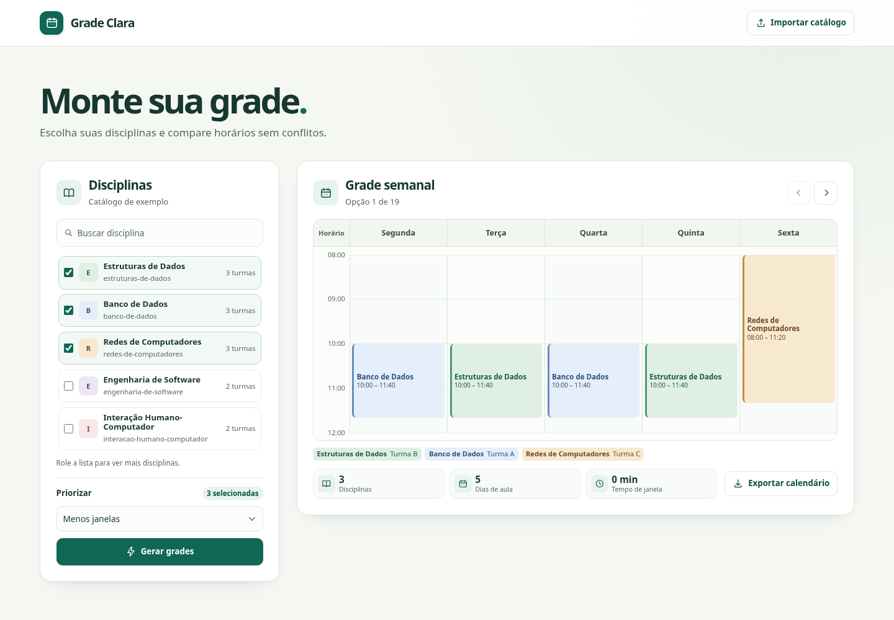

# Grade Clara

Grade Clara monta horários acadêmicos combinando as turmas disponíveis de cada disciplina. Você pode comparar opções por tempo livre entre aulas, número de dias no campus ou horário de saída, e levar a grade escolhida para o seu calendário.



## Como rodar

Com Node.js 22 ou superior, abra o terminal na raiz do repositório.

```bash
npm start
```

Acesse `http://127.0.0.1:4173`. O projeto roda sem instalar dependências.

## Como usar

1. Abra a página para explorar o catálogo fictício de computação e a seleção inicial de exemplo.
2. Selecione suas disciplinas, escolha uma prioridade e clique em **Gerar grades**.
3. Compare as opções pelas setas e confira as turmas, o total de dias e o tempo entre aulas.
4. Clique em **Exportar calendário**, escolha a segunda-feira de início e o número de semanas. Importe o arquivo `.ics` no seu aplicativo de calendário.

A seleção, a prioridade e o catálogo importado são salvos no navegador quando o armazenamento local está disponível. Ao exportar, os horários são interpretados como locais pelo aplicativo de calendário.

## Catálogo próprio

Em **Importar catálogo**, você pode baixar o exemplo completo ou importar um arquivo JSON com esta estrutura. Use identificadores únicos para disciplinas e identificadores de turmas únicos dentro de cada disciplina. Cada turma pode ter mais de um encontro.

```json
[
  {
    "id": "algoritmos",
    "name": "Algoritmos",
    "sections": [
      {
        "id": "A",
        "name": "Turma A",
        "meetings": [
          { "day": 1, "start": "08:00", "end": "09:40" },
          { "day": 3, "start": "08:00", "end": "09:40" }
        ]
      }
    ]
  }
]
```

Os dias vão de `1` (segunda-feira) a `5` (sexta-feira). Os horários usam `HH:MM` no formato de 24 horas. O arquivo pode ter até 1 MB, 40 disciplinas e até 12 turmas por disciplina. Cada turma pode ter até 12 encontros. Para voltar aos dados da demonstração, abra o diálogo de importação e use **Restaurar exemplo**.

## Como as grades são geradas

O algoritmo usa *backtracking* para escolher uma turma por disciplina. Ele interrompe um ramo assim que encontra dois encontros que se sobrepõem no mesmo dia. Aulas consecutivas são permitidas. Para calcular as janelas, soma os intervalos entre aulas em cada dia da semana.

A ordenação aplica a prioridade escolhida e usa os demais critérios e os identificadores das turmas para desempatar. O programa conta todas as soluções válidas e guarda até as 24 melhores. Para limitar o tempo de busca no navegador, uma seleção pode ter até 200 mil combinações candidatas antes da remoção de conflitos.

## Testes

```bash
npm test
```

Os testes verificam conflitos, ordenação, importação e a geração do calendário.

| Arquivo | Responsabilidade |
|---|---|
| `src/scheduler.mjs` | Validação de catálogos e geração e ordenação de grades |
| `src/catalog.mjs` | Catálogo fictício para demonstração |
| `src/calendar.mjs` | Exportação de horários recorrentes para iCalendar |
| `src/app.mjs` | Interface, importação e armazenamento local |
